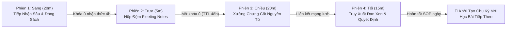

# Cognitive Lattice Engine (CLE) v1.0.0

[](https://opensource.org/licenses/MIT)
[](https://nextjs.org/)
[](https://www.typescriptlang.org/)
[](https://www.postgresql.org/)
[-emerald)](https://vitest.dev/)
[-orange)](https://github.com/open-spaced-repetition/fsrs4anki)

**Cognitive Lattice Engine (CLE)** là hệ điều hành nhận thức và quản trị tri thức chuyên sâu thế hệ mới dành cho nhà nghiên cứu, kỹ sư phần mềm và người học chuyên nghiệp. 

Hệ thống kết hợp chặt chẽ giữa **Khoa học Nhận thức (Cognitive Science)** và **Kỷ nguyên AI**:
- **Tải bớt nhận thức hiệu quả (Productive Offloading):** Tận dụng đại mô hình suy luận sâu (*Gemini 4 Argon High Thinking*) như một *Công cụ Nhận thức (Cognitive Tool)* để chưng cất nguyên lý gốc theo chuẩn schema `CLE_INGEST_V1`, triệt tiêu hoàn toàn thói quen sao chép mù quáng (*Substitutive Offloading*).
- **Quy trình chuẩn SOP 60 phút/ngày:** 4 phân hệ Sáng – Giữa Ngày – Chiều – Tối với các cơ chế cưỡng chế ma sát nhận thức tích cực (*Desirable Difficulty*).
- **Mô hình ghi nhớ FSRS-5 (DSR):** Tối ưu hóa chu kỳ lặp lại ngắt quãng bằng thuật toán đan xen tương phản cực đại (*Max-Contrast Greedy Ordering*).
- **Mạng lưới Zettelkasten WebGL:** Đồ thị tri thức động tích hợp nhúng vector 1536 chiều và thuật toán phân cụm CoSE.
- **Nhật ký Quyết định & Kiểm toán Brier Score:** Đóng băng cam kết quyết định và hiệu chuẩn độ tin cậy dự báo tại mốc 30–60–90 ngày.

---

## 🏛 4 Quy Tắc Trạng Thái Bất Biến (System Invariants)

1. **`RULE-01`: Zero-Highlighting & Tái Cấu Trúc Bắt Buộc**
   - Vô hiệu hóa tính năng bôi màu (highlighting/underlining) thụ động.
   - Bắt buộc điền phiếu kiểm định lập luận phản biện (*Critical Argument Audit Rubric*) và ma trận loại suy chéo miền (*Analogical Transfer Matrix* $\ge 3$ miền tri thức).
2. **`RULE-02`: Ngắt Mạch Nợ Nhận Thức (Cognitive Debt Circuit Breaker)**
   - Tự động khóa cổng nạp tri thức mới khi chỉ số nợ nhận thức $\text{DRLI} > 1.5$ hoặc có $> 5$ *Fleeting Notes* quá hạn. Bắt buộc chuyển toàn bộ 60 phút sang *System Refactoring Mode* để bảo vệ 95% tri thức cũ theo quy luật tiệm cận Wozniak.
3. **`RULE-03`: Giàn Giáo Thích Ứng & Chống Tích Hợp Vội Vã**
   - Khái niệm mới phải vượt qua tối thiểu $2$ chu kỳ truy xuất đơn miền (`reps >= 2`) trước khi được đưa vào bể trộn đan xen đa miền (*Interleaving Pool*).
4. **`RULE-04`: Cam Kết Trước Khi Tiết Lộ (Commit-Before-Reveal)**
   - Vô hiệu hóa thao tác lật thẻ tức thì. Bắt buộc gợi nhớ chủ động và gõ phân tích trước khi hệ thống mở đáp án.

---

## 🚀 Cầu Nối Frontier AI: Gemini 4 Argon High Thinking (`CLE_INGEST_V1`)

Hệ thống tích hợp chuẩn giao thức dữ liệu `CLE_INGEST_V1` cho phép nạp lộ trình 5 ngày chưng cất từ **Gemini 4 Argon High Thinking**:

```json
{
  "protocol": "CLE_INGEST_V1",
  "version": "1.0",
  "roadmap_title": "Lộ Trình Tư Duy Hệ Thống Chuyên Sâu 5 Ngày",
  "modules": [
    {
      "day_number": 1,
      "module_id": "SYS-01",
      "concept_name": "Quy Luật Tiệm Cận Wozniak & Nợ Nhận Thức",
      "activation_context": "Bối cảnh kích hoạt não bộ chuẩn bị tiếp nhận...",
      "hypothesis_prompt": "Nếu một người nạp thêm 20 thẻ flashcard mỗi ngày không giới hạn...",
      "primary_source_text": "Toàn văn tài liệu nguyên lý gốc đóng sách...",
      "scaffolding_questions": ["Câu hỏi giàn giáo 1", "Câu hỏi giàn giáo 2"],
      "suggested_zettel": {
        "atomic_title": "Nợ Nhận Thức Tăng Trưởng Phi Tuyến Khi Không Có Cơ Chế Ngắt Mạch",
        "body_text": "Nội dung phiếu nguyên tử cô đọng 100-350 từ...",
        "domain_category": "Cognitive Science"
      },
      "perturbation_scenarios": [
        {
          "scenario_type": "BOUNDARY_EXTREME",
          "front_prompt": "[Biên cực hạn]: Khi số lượng thẻ đến hạn vượt quá 1000 thẻ...",
          "back_structure": "Hệ quả định lượng và cơ chế phản ứng của bộ nhớ..."
        }
      ]
    }
  ]
}
```

- **Tự động kích hoạt tiền ngữ cảnh (`activation_context`):** Hiển thị ngay tại Cổng Đoán Trước Phiên Sáng giúp người học định hình mô hình tư duy trước khi bấm giờ 180 giây.
- **Theo dõi tiến độ lộ trình 5 ngày:** Lưu trữ trạng thái `completed_module_ids` trong `user_cognitive_settings`, tự động đánh dấu hoàn thành và cho phép chọn nhanh bài học tiếp theo.
- **Kịch bản nhiễu loạn định lượng:** Tự động điền 3 tình huống nhiễu loạn (Biên cực đại, Đảo ngược tham số, Tương phản đa miền) vào Xưởng thiết kế thẻ FSRS Phiên Chiều.

---

## ⏱ Quy Trình Thao Tác Chuẩn 60 Phút (Daily SOP 4 Phân Hệ)



### 1. Phân Hệ 1 • Phiên Sáng (20 Phút) — Tiếp Nhận Sâu & Ghi Chú Đóng Sách
- **Cổng Đoán Trước (Prediction Gate):** Bắt buộc gõ tối thiểu $\ge 50$ từ giả định trong 180 giây trước khi hệ thống mở khóa văn bản nguồn.
- **Văn bản Đọc Không Bôi Màu (Zero-Highlighting):** Triệt tiêu thói quen tô màu vô thức (*Fluency Illusion*).
- **Trình Soạn Thảo Đóng Sách (Closed-Book Literature Editor):** Ẩn hoàn toàn tài liệu gốc, cấm dán (`paste blocked`), yêu cầu tự diễn đạt bằng ngôn ngữ của chính mình từ $50$ đến $200$ từ.
- **Khóa Ủ Nhận Thức (Neural Incubation Lock):** Tự động kích hoạt đếm ngược 4 giờ cưỡng chế phân tán (*Diffuse Mode*) theo quy luật sinh học.

### 2. Phân Hệ 2 • Giữa Ngày (5 Phút) — Hộp Đệm Ghi Chú Thoáng Qua
- **Đếm ngược thời gian ủ:** Ngăn chặn việc chuyển hóa vội vã từ tài liệu sang Zettel trước khi não bộ củng cố synap.
- **Hộp thư Fleeting Notes:** Ghi nhanh các suy nghĩ nảy sinh trong ngày.
- **Hard TTL 48 Giờ:** Bất kỳ Fleeting Note nào không được xử lý trong vòng 48 giờ sẽ bị hệ thống worker tự động xóa cứng để triệt tiêu Ngụy biện Tích trữ (*Hoarding Fallacy*).

### 3. Phân Hệ 3 • Chiều (20 Phút) — Xưởng Chưng Cất Zettelkasten Nguyên Tử
- **Atomic Zettel Studio:**
  - Tiêu đề mang tính mệnh đề khẳng định (cấm đặt tiêu đề là câu hỏi `?`).
  - Thân bài nguyên tử $100 - 350$ từ, đứng độc lập và tự mang đầy đủ nghĩa.
  - Cưỡng chế $\ge 2$ liên kết hai chiều với các Zettel đã có trong kho (`[[UID]]`), kèm lý giải quan hệ ngữ nghĩa tối thiểu $\ge 30$ ký tự.
- **Perturbation Card Studio (Xưởng Thiết Kế Thẻ FSRS):**
  - Chuyển hóa nguyên lý thành 3 thẻ FSRS chống học vẹt: *Biên cực hạn*, *Đảo ngược tham số*, và *Loại suy chéo miền*.
  - Cho phép chỉnh sửa trực tiếp (`inline editing`) `front_prompt` và `back_structure`.
  - Quy chuẩn chống học vẹt: Bắt buộc độ dài $\ge 80$ ký tự cho cả câu hỏi và đáp án cấu trúc.

### 4. Phân Hệ 4 • Tối (15 Phút) — Truy Xuất Đan Xen & Nhật Ký Quyết Định
- **Gợi Nhớ Trang Trắng (Blank-Page Recall Canvas):** 5 phút tái hiện lại toàn bộ tri thức đã học trong ngày từ con số không, tự động tính điểm bao phủ từ khóa.
- **Hàng Đợi Truy Xuất Đan Xen FSRS-5 (Interleaved Retrieval Queue):** Sắp xếp thẻ theo thuật toán tham lam tối đa hóa độ tương phản ngữ nghĩa $J(c_t, c)$, kèm đo lường bước nhảy độ ổn định $\Delta S$ và cập nhật 19 trọng số FSRS-5.
- **Nhật Ký Quyết Định 7 Trường (Decision Journal):**
  - Điền khung quyết định, xác suất kịch bản, tâm thế cảm xúc, các giải pháp thay thế bị loại bỏ, và phân tích hệ quả bậc 2 & bậc 3 (`second_third_order_effects`).
  - Khóa bất biến (`is_locked = true`) chống ngụy biện sau sự thật (*Hindsight Bias*).
  - Tự động lên lịch kiểm toán sau 30, 60, và 90 ngày để chấm điểm **Brier Score**.
- **Nút Khởi Tạo Chu Kỳ Luyện Tập Mới:** Cho phép người học bắt đầu ngay bài tiếp theo trong lộ trình 5 ngày bất kỳ lúc nào.

---

## 🗄 Cấu Trúc 9 Bảng Cơ Sở Dữ Liệu & 4 Database Triggers

Hệ thống vận hành trên kiến trúc quan hệ chuẩn xác gồm **9 bảng** và **4 Database Triggers** bảo vệ tính toàn vẹn:

```
┌───────────────────────────┐       ┌───────────────────────────┐
│     learning_sessions     │       │      fleeting_notes       │
│  (SOP 60m daily records)  │       │  (48-hour hard TTL buffer)│
└─────────────┬─────────────┘       └───────────────────────────┘
              │
              ▼
┌───────────────────────────┐       ┌───────────────────────────┐
│     literature_notes      │◄──────┤     permanent_zettels     │
│ (Closed-book summaries)   │       │(Atomic 1536-d embeddings) │
└───────────────────────────┘       └───────┬───────────┬───────┘
                                            │           │
                     ┌──────────────────────┘           └──────────────────────┐
                     ▼                                                         ▼
       ┌───────────────────────────┐                             ┌───────────────────────────┐
       │       zettel_links        │                             │        fsrs_cards         │
       │(Bidirectional rationale)  │                             │ (DSR Memory Model Queue)  │
       └───────────────────────────┘                             └─────────────┬─────────────┘
                                                                               │
       ┌───────────────────────────┐                                           ▼
       │     decision_journals     │                             ┌───────────────────────────┐
       │(Locked audit, Brier Score)│                             │     fsrs_review_logs      │
       └───────────────────────────┘                             │ (Stability jump telemetry)│
                                                                 └───────────────────────────┘
       ┌───────────────────────────┐
       │ user_cognitive_settings   │
       │ (FSRS-5 weights, roadmap) │
       └───────────────────────────┘
```

### Chi Tiết 9 Bảng Dữ Liệu
1. `learning_sessions`: Quản lý trạng thái tiến trình 4 phân hệ trong ngày, mốc ủ 4 giờ và điểm nợ nhận thức DRLI.
2. `fleeting_notes`: Hộp đệm ghi chép nhanh với thời hạn sống cứng (TTL) 48 giờ.
3. `literature_notes`: Ghi chú tài liệu đóng sách, kèm ma trận loại suy chéo miền và bảng kiểm tra lập luận.
4. `permanent_zettels`: Phiếu tri thức nguyên tử Zettelkasten kèm vector nhúng 1536 chiều `vector(1536)`.
5. `zettel_links`: Liên kết ngữ nghĩa hai chiều giữa các Zettel, bắt buộc trường lý giải quan hệ.
6. `fsrs_cards`: Thẻ ghi nhớ FSRS-5 lưu trữ 3 trạng thái DSR ($D$: Difficulty, $S$: Stability, $R$: Retrievability).
7. `decision_journals`: Nhật ký quyết định chuyên sâu 7 trường, bảo vệ chống sửa đổi lịch sử.
8. `fsrs_review_logs`: Nhật ký đo lường bước nhảy độ ổn định $\Delta S$ sau mỗi lượt chấm điểm thẻ.
9. `user_cognitive_settings`: Lưu trữ vector 19 trọng số FSRS-5, tiến độ lộ trình 5 ngày (`completed_module_ids`) và tỷ lệ ghi nhớ mục tiêu.

### 4 Database Triggers Bất Biến
1. **`trg_set_incubation_unlock`:** Tự động cộng chính xác 4 giờ vào `incubation_unlock_at` ngay khi `s1_completed_at` được ghi nhận.
2. **`trg_block_zettel_mutation`:** Cấm sửa đổi tiêu đề và nội dung phiếu Zettel một khi đã xuất bản để bảo toàn bất biến lịch sử tri thức.
3. **`trg_audit_link_rationale`:** Cưỡng chế độ dài lý giải quan hệ liên kết tối thiểu $\ge 30$ ký tự, triệt tiêu liên kết hời hợt.
4. **`trg_lock_decision_journal`:** Đóng băng toàn bộ các trường cam kết quyết định, chỉ cho phép điền kết quả hậu kiểm và điểm Brier.

---

## 💾 Kiến Trúc Cơ Sở Dữ Liệu Kép & Lưu Trữ Bền Vững (Dual-Mode)

CLE hỗ trợ cả hai mô hình triển khai mượt mà không yêu cầu cấu hình phức tạp:

| Đặc Tính | Chế Độ Local-First (PGlite) | Chế Độ Production (PostgreSQL 16) |
|---|---|---|
| **Cơ Chế** | Nhúng trực tiếp `@electric-sql/pglite` vào tiến trình Node.js | Kết nối máy chủ PostgreSQL 16 bên ngoài qua `DATABASE_URL` |
| **Tiện Ích Vector** | Extension `@electric-sql/pglite/vector` tải động | Tiện ích `pgvector` native |
| **Lưu Trữ** | Tự động lưu bền vững xuống thư mục `.cle-pglite-data/` | Lưu trữ tập trung trên máy chủ PostgreSQL |
| **Môi Trường Test** | Chạy in-memory hoàn toàn tách biệt, tốc độ tối đa cho Vitest | Có thể cấu hình test database riêng |
| **Singleton Safety** | Đăng ký trên `globalThis` chống rò rỉ file lock khi HMR Next.js 15 | Quản lý pool kết nối tự động |

---

## 📦 Sao Lưu & Khôi Phục Toàn Diện Hộp Phiếu 6 Bảng (Vault Export / Import)

Hệ thống bảo đảm người học làm chủ hoàn toàn dữ liệu của mình (Local-First Data Ownership):
- **Xuất Snapshot JSON Chuẩn Hóa:** Xuất toàn bộ 6 bảng nghiệp vụ cốt lõi (`permanent_zettels`, `zettel_links`, `decision_journals`, `literature_notes`, `fsrs_cards`, `user_cognitive_settings`).
- **Xuất Markdown Tương Thích Obsidian & Logseq:** Tự động chuyển đổi toàn bộ Zettel thành các tệp `.md` kèm Frontmatter metadata và liên kết hai chiều `[[UID]]`.
- **Khôi Phục Không Xung Đột (Vault Import):** Tự động phân giải thứ tự khóa ngoại, tạo người dùng nếu chưa có, và phục hồi chính xác tiến độ lộ trình 5 ngày.

---

## 📊 Bảng Điện Tâm Đồ Nhận Thức (Cognitive Telemetry Dashboard)

Bảng điều khiển trực quan hóa 4 thước đo nhận thức chuyên sâu:
1. **Atomic Zettel Velocity:** Nhịp độ sản sinh thẻ nguyên tử hàng tuần (mục tiêu $3 - 7$ Zettels/tuần).
2. **Memory Stability Jump Telemetry:** Đo lường bước nhảy độ ổn định thực tế $\Delta S = S_{after} - S_{before}$ tại vùng ma sát tối ưu $R \in [70\%, 85\%]$.
3. **Forgetting Index Calibration:** Hiệu chuẩn chỉ số quên thực tế so với mục tiêu ($FI_{target} = 10\%$) và vector 19 tham số $\mathbf{w}$.
4. **Decision Calibration Matrix:** Phân bổ dự báo xác suất và đường cong hiệu chuẩn Brier Score ($BS \in [0, 2]$).
5. **Mạng Lưới WebGL Cytoscape.js:** Đồ thị quan hệ Zettel phân cụm ngữ nghĩa tự động bằng thuật toán CoSE khi số lượng node $\ge 50$.

---

## 🧪 Kiểm Thử Tự Động Toàn Diện (14 Test Suites • 124 Tests PASS)

Toàn bộ logic nghiệp vụ, thuật toán và ràng buộc cơ sở dữ liệu được bảo vệ bởi 14 bộ kiểm thử tự động trên Vitest:

| Tệp Kiểm Thử | Số Bài Test | Trọng Tâm Kiểm Thử |
|---|---|---|
| `tests/algorithms.test.ts` | 19 tests | Mô hình FSRS-5 DSR, Ngắt mạch DRLI, Xếp lịch đan xen Max-Contrast, BullMQ Workers |
| `tests/db_triggers.test.ts` | 4 tests | 4 Database Triggers bảo vệ bất biến trạng thái |
| `tests/e2e_workflow.test.ts` | 7 tests | Khép kín luồng nghiệp vụ SOP 60 phút qua 4 phân hệ |
| `tests/phase7_production.test.ts` | 7 tests | Vector Interleaving 1536 chiều, Tối ưu hóa FSRS, Tra cứu DOI học thuật |
| `tests/phase8_release_v1.test.ts` | 5 tests | Thích ứng co giãn DRLI (Mục 2.3.3), Phẫu thuật thẻ đỉa Leech Quarantine |
| `tests/phase9_frontier_ai_bridge.test.ts` | 6 tests | Cầu nối Gemini 4 Argon (`CLE_INGEST_V1`), Nút tua nhanh khóa ủ 4 giờ |
| `tests/phase10_coldstart_and_vault.test.ts` | 5 tests | Nút hạt giống Cold-Start, Tiến độ lộ trình 5 ngày, Nhập kho Vault Import |
| `tests/phase11_final_gold_release.test.ts` | 9 tests | Kịch bản nhiễu loạn, Sao lưu 6 bảng, Chấm điểm gợi nhớ trang trắng |
| `tests/phase12_fsrs_card_studio_hotfix.test.ts` | 11 tests | Chỉnh sửa trực tiếp thẻ, Chuẩn chống học vẹt $\ge 80$ ký tự |
| `tests/phase13_evening_and_decision_complete.test.ts` | 4 tests | Nhật ký quyết định đầy đủ 7 trường, Bước nhảy độ ổn định $\Delta S$ |
| `tests/socratic_ai.test.ts` | 11 tests | Đa tác tử Socratic (Mentor–Critic Loop), Tích hợp Embeddings |
| `tests/state_machines.test.ts` | 7 tests | Máy trạng thái SOP, Kiểm định lập luận, Ma trận loại suy |
| `tests/telemetry.test.ts` | 8 tests | Đo lường Brier Score, Vận tốc Zettel, Chỉ số quên |
| `tests/validations.test.ts` | 21 tests | Bộ schema xác thực Zod cho toàn bộ 9 bảng và DTO |
| **TỔNG CỘNG** | **124 TESTS** | **100% PASS TUYỆT ĐỐI** |

---

## 🛠 Hướng Dẫn Cài Đặt & Vận Hành

### Yêu Cầu Môi Trường
- **Node.js:** 18.18+ hoặc 20+
- **NPM / PNPM**

### Khởi Chạy Nhanh (Local-First — Không Cần Cài Đặt PostgreSQL)

```bash
# 1. Cài đặt các gói phụ thuộc
npm install

# 2. Khởi chạy máy chủ phát triển
npm run dev
```

Mở trình duyệt tại [http://localhost:3000](http://localhost:3000). Dữ liệu sẽ được tự động lưu bền vững vào thư mục `.cle-pglite-data/`.

### Chạy Kiểm Thử Nghiệm Thu

```bash
# Kiểm tra TypeScript
npm run typecheck

# Chạy toàn bộ 124 bài kiểm thử Vitest
npx vitest run

# Đóng gói sản phẩm Production
npm run build
```

---

## 📄 Bản Quyền

Dự án được phát hành theo giấy phép [MIT License](LICENSE).
Mọi đóng góp nhằm nâng cao năng lực nhận thức con người trong kỷ nguyên AI đều được chào đón!
